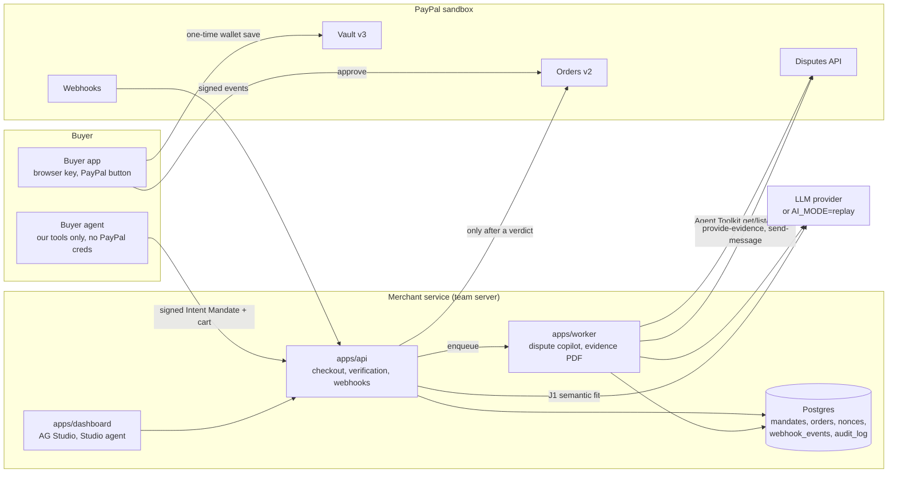

# Architecture



## Request paths

**Checkout (spec 0003).** Buyer agent → `POST /checkout` with the signed Intent Mandate, Payment Mandate and a
proposed cart → structural, cryptographic and freshness checks (`packages/mandates`) → hard rules
(`packages/policy-engine`) → J1 semantic fit (`packages/ai`) → verdict. Only APPROVE or STEP_UP produce a signed
Cart Mandate and a PayPal order (`packages/paypal`). The mandate pointer goes into `custom_id`.

**Dispute (spec 0005).** PayPal webhook → `POST /webhooks/paypal` → verify signature → persist (unique event id)
→ enqueue `dispute.received` → worker fetches the dispute, replays the same policy engine, replays J1, classifies
(J2), drafts evidence (J3) → operator reviews in the dashboard → the operator's click triggers the one PayPal action
they chose. Every step is appended to `audit_log`.

## Dependency direction

```
apps/*  →  packages/{policy-engine, mandates, paypal, ai, db}  →  packages/contracts
```

- `packages/contracts` depends on nothing but zod. Everything else imports types from it.
- `packages/policy-engine` is pure: no I/O, no clock (the caller passes `now`), no randomness.
- Apps never import from other apps. Shared logic moves into a package.
- Only `apps/api` and `apps/worker` hold PayPal credentials. The buyer side never does.

## Invariants (each has a test)

1. No PayPal order exists for a rejected cart.
2. The LLM can only lower a verdict, never raise it, and never calls PayPal.
3. The dispute copilot replays the same rules as checkout, so the two verdicts can't contradict.
4. Every dispute action follows an operator click recorded in the audit log.
5. Evidence is generated from the audit log, so it reflects what was true at capture time.

## Modes

| Variable | Values | Default | Effect |
|---|---|---|---|
| `PAYPAL_MODE` | `mock`, `sandbox` | `mock` | `mock` returns fixture payloads; no credentials |
| `AI_MODE` | `replay`, `live` | `replay` | `replay` serves recorded responses keyed by input hash; no API key |
