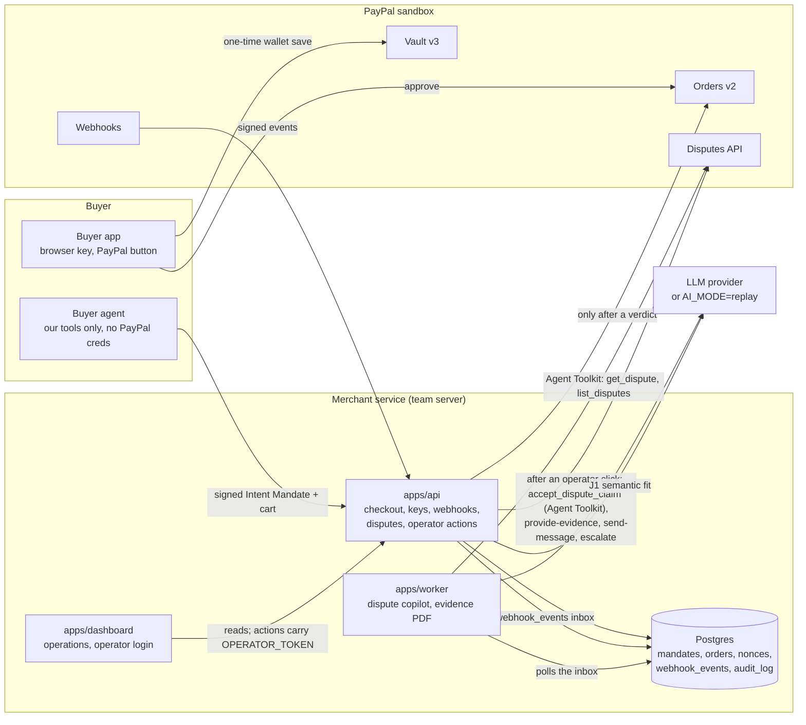

# Architecture



## Request paths

**Checkout (spec 0003).** Buyer agent → `POST /checkout` with the signed Intent Mandate, Payment Mandate and a
proposed cart → structural, cryptographic and freshness checks (`packages/mandates`) → hard rules
(`packages/policy-engine`) → J1 semantic fit (`packages/ai`) → verdict. Only APPROVE or STEP_UP produce a signed
Cart Mandate and a PayPal order (`packages/paypal`). The mandate pointer goes into `custom_id`.

**Dispute (spec 0005).** PayPal webhook → `POST /webhooks/paypal` → verify signature → persist (unique event id);
that row is the worker's inbox. The worker polls it, re-reads the dispute with the Agent Toolkit's `get_dispute`,
matches `invoice_number` to our order, replays the same policy engine at capture time, classifies with the
deterministic tree and builds the evidence PDF for MANDATE_COMPLIANT. Every 5 minutes a `list_disputes` catch-up
picks up disputes whose webhook never arrived. The operator reviews in the dashboard (login required to act); the
click hits `POST /disputes/:id/actions/:action`, which writes the operator's audit row **before** the one PayPal
call. The worker never calls a dispute action.

**Keys (spec 0001).** A shopper's browser registers its P-256 public key at `POST /keys/shopper` (public); agent
platforms are registered by the operator at `POST /keys/agent`. Key ids are the key's RFC 7638 thumbprint.

## Dependency direction

```
apps/*  →  packages/{policy-engine, mandates, paypal, ai, db}  →  packages/contracts
```

- `packages/contracts` depends on nothing but zod. Everything else imports types from it.
- `packages/policy-engine` is pure: no I/O, no clock (the caller passes `now`), no randomness.
- Apps never import from other apps. Shared logic moves into a package.
- Only `apps/api` and `apps/worker` hold PayPal credentials. The buyer side never does.

## Invariants (each has a test)

1. No PayPal order exists for a rejected cart.
2. The LLM can only lower a verdict, never raise it, and never calls PayPal.
3. The dispute copilot replays the same rules as checkout, so the two verdicts can't contradict.
4. Every dispute action follows an operator click recorded in the audit log.
5. Evidence is generated from the audit log, so it reflects what was true at capture time.

## Modes

| Variable | Values | Default | Effect |
|---|---|---|---|
| `PAYPAL_MODE` | `mock`, `sandbox` | `mock` | `mock` returns fixture payloads; no credentials |
| `AI_MODE` | `replay`, `live` | `replay` | `replay` serves recorded responses keyed by input hash; no API key |
| `OPERATOR_TOKEN` | any long random string | unset | Unset: dispute actions, agent-key registration and retirement answer 503. Same value on api and dashboard |
| `OPERATOR_PASSWORD` | any | unset | Dashboard login (user `operator`) before any action; unset turns actions off |
